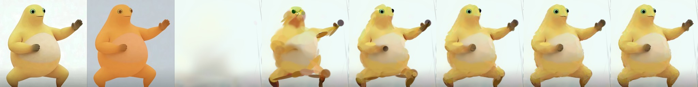
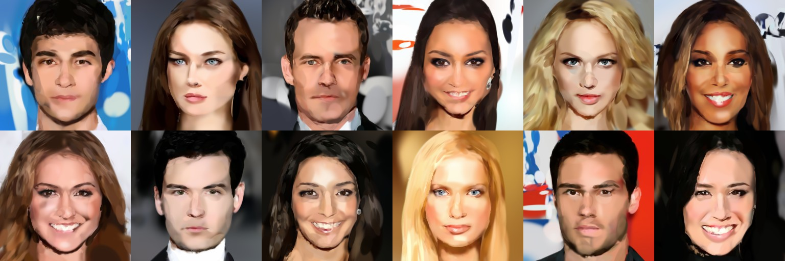
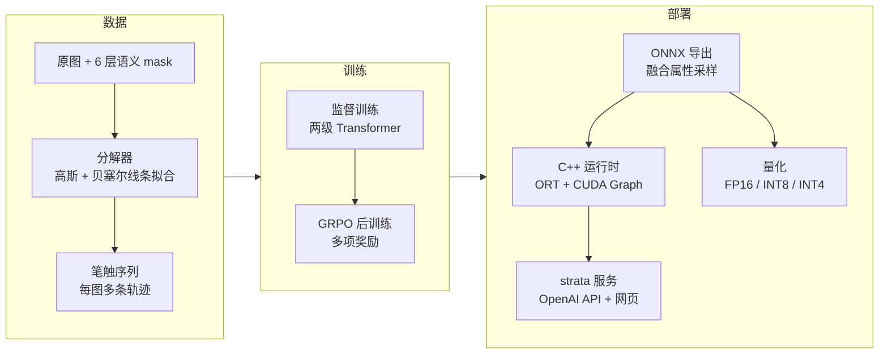

<div align="center">


<h3>一个用可编辑的高斯笔触与贝塞尔线条、按语义图层逐笔作画的自回归图像模型<br>以及从数据、训练到 C++ 推理服务和量化的整套部署工具链</h3>

<p>
<a href="LICENSE"></a>


</p>

<p>
<a href="#亮点">亮点</a> •
<a href="#架构">架构</a> •
<a href="#关键结果">关键结果</a> •
<a href="#本地服务strata">本地服务</a> •
<a href="#快速开始">快速开始</a> •
<a href="#路线图">路线图</a>
</p>

</div>

<p align="center">

<br>
<sub>分解器把一张训练范围外的 3D 卡通图拆成 2 个图层、864 笔广义高斯笔触（29.3 dB，8.1 s）：最左是原图，往右依次是笔触逐步叠加的过程</sub>
</p>

<p align="center">

<br>
<sub>v3 模型（129M）只根据中文描述、一笔一笔画出的人像：48 条验证集描述 × 每条 4 张，从 192 张里挑出 12 张（CFG 5，top-p 0.6；描述与种子见 <a href="assets/img_v3_faces.json">img_v3_faces.json</a>）</sub>
</p>

---

## 亮点

模型不直接输出像素，而是一笔一笔地输出**广义高斯笔触**（位置、大小、角度、边缘硬度、颜色、透明度）和**贝塞尔线条**（发丝、轮廓），
并按 **背景 → 身体 → 皮肤 → 五官 → 头发 → 配饰** 的图层顺序作画。生成结果天然就是分层的，可以继续编辑，也可以只重画其中一层。

| 方向 | 内容 |
|---|---|
| **语义分层协议** | `LAYER_k` / `REDRAW_k` / `REFINE_k` 事件。可以只重画头发、只给五官补细节，导出分层 ORA / SVG |
| **广义高斯 + 贝塞尔线条** | 边缘硬度 β 让同一种图元既能做柔边喷枪、也能做硬边色块；v3 加入二次贝塞尔线条画发丝和轮廓；分解器量化感知拟合，训练目标 24.9 → **30.2 dB** |
| **两级 Transformer + 画布反馈** | 每一笔在主干里只占一个位置，序列短了 9 倍；每 32 笔渲染一次画布，通过门控交叉注意力送回主干 |
| **自研算子** | Triton tile 光栅化（前向 + 反向）让分解器快 **64×**；同一份 CUDA 源码经 hipify 跑在海光 DCU 上，算子比 PyTorch 稠密实现快 **9–38×** |
| **防作弊的 GRPO** | 奖励分项各自归一化，用独立评委 CLIP 和留出属性验收，抓到了奖励作弊并提前停止 |
| **C++ 运行时 + 量化** | ORT 1.32 + CUDA Graph + 原地 KV cache，small 吞吐 735 → **1010** records/s，输出逐条相同；base 模型融合属性采样 + FP16，B=32 时 340 → **586** records/s |
| **本地推理服务** | 纯 C++ 的 `strata`：OpenAI 兼容接口、流式逐笔输出、请求合批、续画、照图画；`./serve.sh` 一键启动 |
| **异构多机流水线** | RTX 5070 笔记本 + RTX 4090 + 海光 DCU 分工；每次传输都核对 SHA；本机关机时 autopilot 也能自己推进 |

## 架构



| 模型 | 主干（宽 / 层 / 头） | 属性解码器 | 参数 | 文字编码器 |
|---|---|---|---:|---|
| small | 384 / 8 / 6 (GQA 2) | 2 层 | 20.4M | Chinese-CLIP，冻结 |
| base（v3 最终模型） | 768 / 16 / 12 (GQA 4) | 2 层 | **129.3M** | Chinese-CLIP，冻结 |

- **画面表示**：广义高斯图元，premultiplied over 合成满足结合律，所以整张渲染、按层渲染、分块渲染结果完全一致，分层编辑才成立。
- **协议**：每个属性单独量化（x、y 各 512 档，颜色用 4096 色 Oklab 码本），语法 mask 保证序列合法；协议和码本带 SHA，防止跨机器、跨版本混用。
- **上下文**：1024 个记录（每张画约 700 笔），先画所有图层的草稿，再逐层细化。

## 关键结果

<table>
<tr><td valign="top" width="50%">

**v3 模型**（192 条验证描述，独立评委 CLIP ViT-L/14）

| | 真人 R@5 | 动漫 R@5 | 动漫 FD ↓ |
|---|---:|---:|---:|
| 上一版（只有高斯） | 0.380 | 0.375 | 0.227 |
| **v3（+ 贝塞尔线条）** | **0.406** | **0.417** | **0.206** |
| v3，4 选 1 | 0.422 | 0.500 | 0.197 |

</td><td valign="top" width="50%">

**base 模型部署**（C++ 运行时，records/s）

| | B=1 | B=32 |
|---|---:|---:|
| GPU FP32 | 86 | 340 |
| GPU 融合采样 + **FP16** | 98 | **586** |
| CPU FP32 | 29 | 44 |
| CPU 动态 **INT8** | **64** | 50 |

剖析发现每个记录要串行调用约 10 次输出头，
于是把 9 个属性的采样（CFG、top-p、固定槽）融合进一张图，与参考采样器逐 token 一致。

</td></tr>
<tr><td valign="top">

**C++ 运行时优化**（small，B=8，输出逐条相同）

| 改动 | records/s |
|---|---:|
| 起点 | 735 |
| 定形单步图 + CUDA Graph | 743 |
| 原地更新 KV cache | 822 |
| 属性头接 CUDA Graph | 877 |
| 只拷回需要的 logits | **1010** |

B=32：1118 → **1472**（+32%）

</td><td valign="top">

**量化**（单步保真度 + 生成分布两层验收）

| 精度 | 设备 | top-1 一致 | 结论 |
|---|---|---:|---|
| FP16 | GPU | 98.6% | B=32 **+40%** |
| 动态 INT8 | CPU | 87.9% | B=1 **+121%** |
| 仅权重 INT8/4 | GPU | 98.3% | 这个规模不划算 |

CPU 解码带宽受限（每个记录读约 0.9 GB 权重），INT8 把读取量降到 1/4；
GPU 要到 B=32 矩阵乘够大，Tensor Core 才起作用。

</td></tr>
<tr><td valign="top">

**多轨迹数据**（独立评委 CLIP）

| 轨迹 / 图 | 评委 R@5 | 训练-验证损失差 |
|---|---:|---:|
| 1 | 18.8% | 0.10 |
| 4 | **30.2%** | 0.02 |

4 → 12 条：R@1 3.6% → **9.4%**，验证损失却完全一样，
说明只看损失看不出这部分收益。

</td><td valign="top">

**GRPO 后训练**

| 指标 | SFT | GRPO @100 |
|---|---:|---:|
| 评委 R@1 | 7.8% | **13.0%** |
| 留出属性 | — | +1.9 pt |
| 孤儿笔触率 | — | −31% |

到 step 175 时，计入奖励的指标还在涨，评委指标却开始变差（奖励作弊），
所以在 step 100 提前停止。

</td></tr>
</table>

## 本地服务：strata

类似 Ollama 的本地服务，浏览器打开就能看着模型一笔一笔作画。

```sh
./serve.sh            # 首次自动编译、导出模型；之后几秒启动，并打开 http://localhost:11435
./serve.sh status     # 状态；./serve.sh logs 看日志；./serve.sh stop 停止
```

| 能力 | 说明 |
|---|---|
| **纯 C++，不依赖 Python** | 中文描述 → C++ WordPiece 分词（与 HuggingFace 在 16.6 万条描述上逐 id 一致）→ ONNX 文本编码器 → 作画模型 → C++ 渲染 PNG |
| **OpenAI 兼容接口** | `POST /v1/images/generations`、`/v1/images/edits`、`GET /v1/models`，可直接接 Open WebUI 等前端 |
| **流式逐笔输出** | Ollama 风格的 `POST /api/generate`，NDJSON 流式返回作画过程的每一帧 |
| **请求合批** | 一个工作线程独占 GPU，同时到达、参数相同的请求合成一个 batch 解码 |
| **续画** | 只重画某一层（例如把头发改成黑色，脸不变）或在某层继续加笔；C++ 与 PyTorch 逐 token 一致（`tools/continue_parity.py`） |
| **照图画** | 上传任意图片，分解器拆成笔触逐笔画出（29–37.5 dB）；人像由自训的图层分割 U-Net（mIoU 0.76）分出语义图层，宽幅照片里的小人像会自动裁出；也可只拆草稿交给模型续画 |

```sh
curl localhost:11435/v1/images/generations -d '{"prompt": "真人照片，黑色短发的年轻男性，微笑，背景模糊", "seed": 1}'
```

## 快速开始

```sh
# 测试与 demo（需要 PyTorch，CUDA 可选；numpy、pillow、pytest）
python -m pytest
python tools/build_prior_codebooks.py
python tools/render_demo.py    --out out/demo
python tools/decompose_demo.py --out out/decompose   # 合成场景分解报告

# 训练
python tools/train.py --data "data/.../decomp_*.npz" --config small --out runs/small

# 导出 ONNX 并构建 C++ 运行时
python tools/export_onnx.py --ckpt runs/small/last.pt --out out/onnx
cmake -S runtime -B runtime/build && cmake --build runtime/build -j
runtime/run.sh --help

# 本地服务（一键）
./serve.sh
```

<details>
<summary><b>更多：海光 DCU、训练启动</b></summary>

- 部分 DTK 构建会尝试加载未提供的 FlashAttention 库；训练可加 `--sdpa-backend math` 改用 PyTorch 内置注意力。
- 一条完整轨迹的清理、覆盖检查、远程 SHA 校验和训练启动，可用
  `python tools/start_ready_training.py --plan <launch-plan.json>` 串起来。

</details>

## 目录结构

```
protocol.json            序列协议：画布、图元公式、属性词表、事件、图层（Python 与 C++ 共用）
python/lpp/
  model.py  canvas.py    两级 Transformer、画布编码与反馈
  sequence.py sample.py  语法状态机、序列构造、带 KV cache 的采样器
  color.py shape.py      Oklab 颜色空间；形状的 log 协方差参数化
  codebook.py codec.py   k-means 码本；连续参数 <-> token
  export.py              ONNX 导出用的图（含融合属性采样 decode_sample）
  render/                参考光栅化器、Triton / CUDA / HIP tile 光栅化、后端选择
  decompose/             分层分解器：图片 + 图层标签 -> 有序、量化后的图元
csrc/raster/             原生 CUDA/HIP 光栅化算子
runtime/                 C++ 推理运行时（语法、采样、光栅化、ORT 会话、分词器）
  src/server.cpp         本地服务 strata（OpenAI / Ollama 风格接口）
  web/                   网页前端
tools/                   数据处理、训练、GRPO、ONNX 导出、量化、评估、照图画
ops/plan_v3/             多机流水线与 autopilot
bench/                   算子基准测试与优化报告
```

## 路线图

- [x] 序列协议、Oklab 颜色码本、log 协方差形状参数化
- [x] 可微参考光栅化器 + Triton tile 算子（前向/反向，[分解器快 64×](bench/REPORT_raster.md)）
- [x] 原生 CUDA/HIP 算子，同一份源码跑在 NVIDIA 和海光 DCU 上
- [x] 分层分解器：量化感知拟合、amodal 补全、图层越界约束
- [x] CelebAMask-HQ 3 万张 × 12 条轨迹；动漫 5 万张 × 4 条轨迹，约 56 万条序列
- [x] 两级模型（tiny / small / base）、Chinese-CLIP 文字条件 + CFG、画布反馈
- [x] 协议 v2：独立形状分档、版本化颜色码本
- [x] GRPO 后训练与独立评委评估
- [x] ONNX 导出、C++ 运行时、CUDA Graph、FP16/INT8/INT4 量化
- [x] base 模型按训练计划 v3 训练完成：贝塞尔线条 + 草稿顺序
- [x] 属性采样移进计算图（融合采样 + FP16，B=32 达 586 records/s）
- [x] 本地服务 strata：OpenAI 兼容接口、流式、合批、续画、照图画
- [ ] 权重发布到 Hugging Face（CC BY-NC 4.0）
- [ ] TensorRT 后端；连续合批（continuous batching）与压测
- [ ] 多卡 DDP 扩展效率实测

## 已知的局限

- 只会画真人头像和动漫头像两类；其他题材超出训练分布。
- “输入一张图让模型直接画”（残差画布）试了三轮，人脸最高 13.06 dB，没过事先定的 18 dB 线，已按计划停止；当前做法是分解器先拟合草稿，模型接着画完。
- 仅权重量化在 GPU 上没有收益，这是 129M 规模下的结论，不能外推到 1B 以上。

## 许可与致谢

思路受 [Primitive Operation Painter 2](https://github.com/wonderfulearth/primitive-operation-painter) 启发，本项目的代码从头实现。

代码采用 [Apache License 2.0](LICENSE) 发布，第三方组件（cpp-httplib 等）的说明见 [NOTICE](NOTICE)。

训练数据（CelebAMask-HQ、动漫数据集）仅限非商业研究用途，不随仓库分发；模型权重因此以 **CC BY-NC 4.0** 发布。

<div align="center">
<sub>Built from scratch by <a href="https://github.com/G1en-114">@G1en-114</a></sub>
</div>
